# Diagramas de flujo del sistema

**Trabajo Práctico Integrador — Programación Orientada a Objetos 2026 — Lic. Diego L. Mattana**
Sistema de Gestión de un Refugio de Animales (C++17)

Este documento contiene **un diagrama de flujo por cada opción del menú**, como pide la
consigna en los requisitos de entrega, más el diagrama del programa principal y los de las
dos rutinas auxiliares que usan todas las opciones: la lectura validada por teclado y la
selección de un elemento de una lista.

> **El usuario nunca escribe un ID.** Los números internos (ID de animal, de adoptante y
> de solicitud) existen porque son la clave del modelo, pero no se piden por teclado:
> en las altas los pone el refugio y, cuando hay que elegir algo que ya existe, se muestra
> la lista numerada de 1 a N y se elige por posición. Por eso en los diagramas no aparece
> ningún "leer el ID": aparece *pedir el próximo número al refugio* o *elegir de la lista*.

Los diagramas están escritos en **Mermaid**. Se pueden ver de tres formas:

1. Abriendo `DIAGRAMAS.html` en cualquier navegador (no necesita internet).
2. En Visual Studio Code, con la vista previa de Markdown (`Ctrl + Shift + V`) y la
   extensión *Markdown Preview Mermaid Support*.
3. Pegando el contenido de cualquier bloque en <https://mermaid.live>.

**Convención de figuras usada en todos los diagramas:**

| Figura | Significado |
|---|---|
| Óvalo | Inicio / Fin del proceso |
| Paralelogramo | Entrada o salida por consola (`cin` / `cout`) |
| Rectángulo | Proceso: llamada a un método o cálculo |
| Rombo | Decisión |
| Rectángulo con borde doble | Lanzamiento de una excepción (`throw`) |

---

## Programa principal — Menú del sistema

El menú es un `do...while` que se repite hasta que el usuario elige `0`. Toda la operación
elegida se ejecuta dentro de un bloque `try`, por eso **un error nunca corta el programa**:
se muestra el mensaje y el menú vuelve a aparecer.

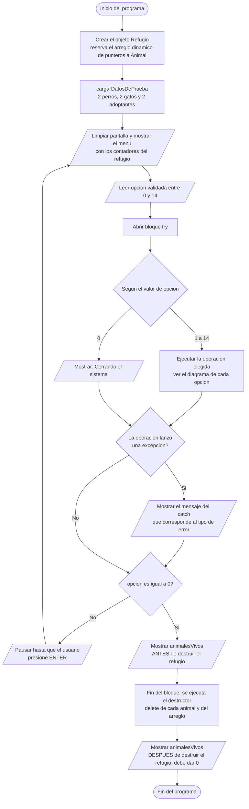

> **Orden de los `catch`:** van del más específico al más general
> (`IdRepetidoException`, `IndiceInvalidoException`, `AnimalNoDisponibleException`,
> `NoEncontradoException`, `RefugioException`, `std::exception`). Si `std::exception`
> estuviera primero atraparía todo y los demás nunca se ejecutarían. Todos capturan
> **por referencia constante**.

---

## Subrutina auxiliar — Lectura validada por teclado

`leerEntero()` es la función que usan casi todas las opciones para pedir números. Aparece
en los demás diagramas como un solo paralelogramo de "Leer ... validado", pero por dentro
hace esto:

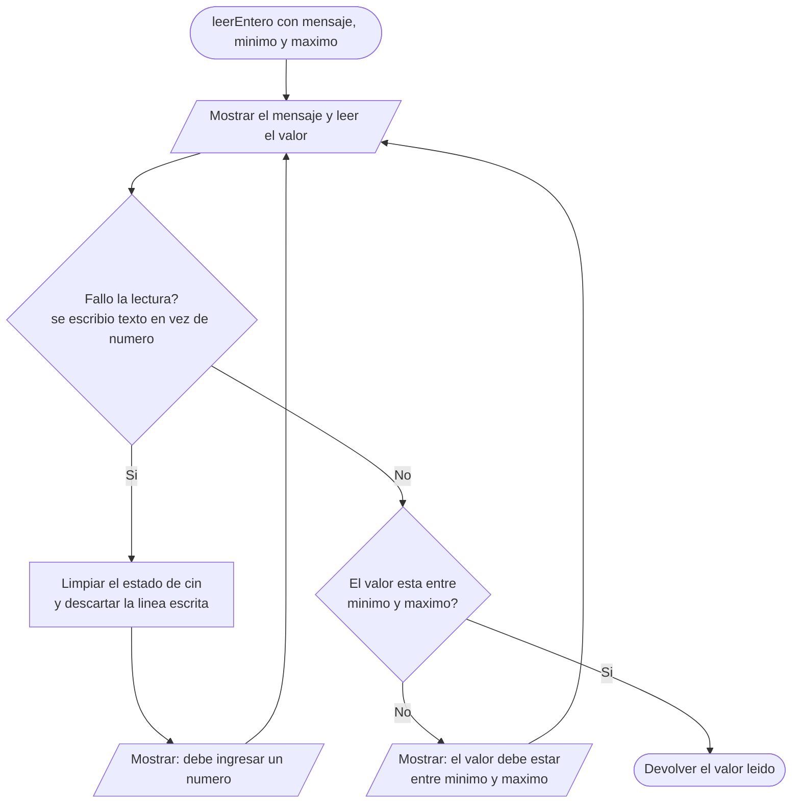

> Por eso en los diagramas de las opciones no se repite la validación de tipo y de rango:
> ya está resuelta acá. Lo mismo hacen `leerTexto()` y `leerSiNo()`.

---

## Subrutina auxiliar — Elegir un elemento de una lista

Es la rutina que reemplazó a "escribir el ID". Las opciones 6 a 10 la usan a través de
`elegirAnimal()`, `elegirAdoptante()` y `elegirSolicitudPendiente()`, que trabajan todas
igual: muestran la lista numerada, leen **un número de esa lista** y devuelven el ID
interno del elemento elegido. En los diagramas de esas opciones aparece como un solo
paralelogramo de "Elegir ... de la lista".

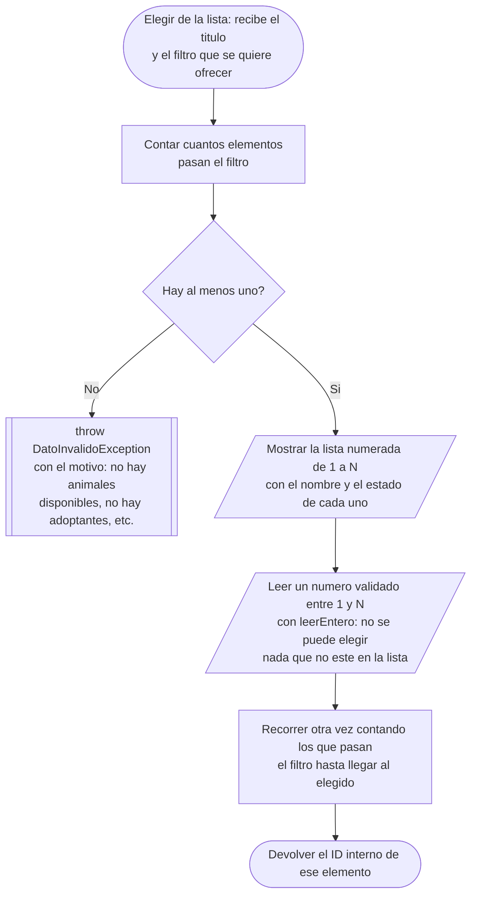

> **Por qué hace falta el último paso:** el número que ve el usuario **no** es la posición
> en el catálogo. Si se están ofreciendo sólo los animales disponibles, el `1` de la lista
> puede ser el animal que está guardado en la posición 3. Por eso se vuelve a recorrer
> aplicando el mismo filtro hasta llegar al que eligió. En `elegirAdoptante()` ese paso no
> existe, porque ahí no hay filtro y el número de lista coincide con la posición.
>
> Como `leerEntero()` ya acota la respuesta al rango `1..N`, **ninguna de estas rutinas
> necesita validar la elección**: no se puede elegir algo que no exista.

---

## Opción 1 — Registrar perro

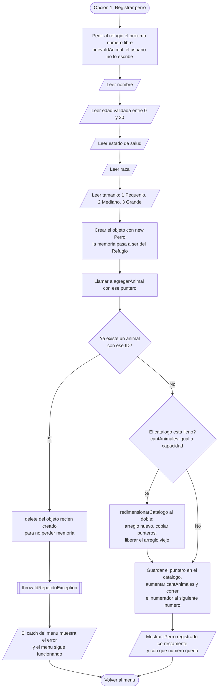

> **Memoria (Fase 2):** el `new` se hace en `MenuConsola.cpp` y la propiedad de ese bloque pasa al
> `Refugio` apenas se llama a `agregarAnimal()`. Si el alta se rechaza por ID repetido, el
> propio `agregarAnimal()` hace el `delete` **antes** de lanzar la excepción.
>
> **El control de ID repetido ya no se puede disparar desde el menú**, porque el número lo
> pone el propio refugio. Queda igual dentro de `agregarAnimal()` como red de seguridad del
> modelo, y es la que se prueba a propósito en la opción 14.

---

## Opción 2 — Registrar gato

Mismo circuito que la opción 1, pero con los atributos propios de `Gato`.

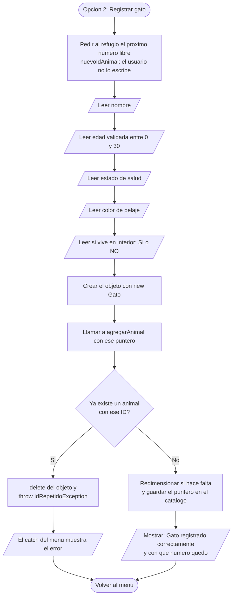

---

## Opción 3 — Listar todos los animales

Recorrido **polimórfico**: se llama siempre a `mostrarInfo()` y la ligadura dinámica decide
si ejecuta la versión de `Perro` o la de `Gato`.

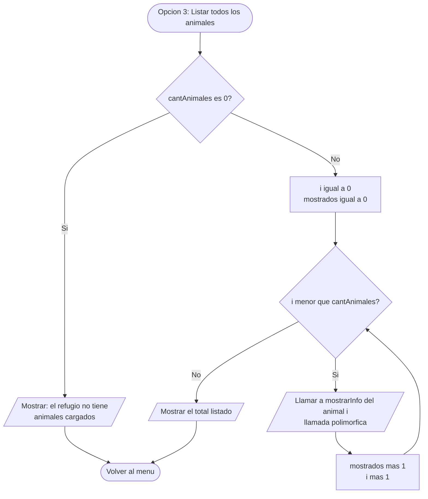

---

## Opción 4 — Listar animales disponibles

Es el mismo recorrido de la opción 3 pero con un filtro: se saltea todo animal que no esté
en estado `DISPONIBLE`.

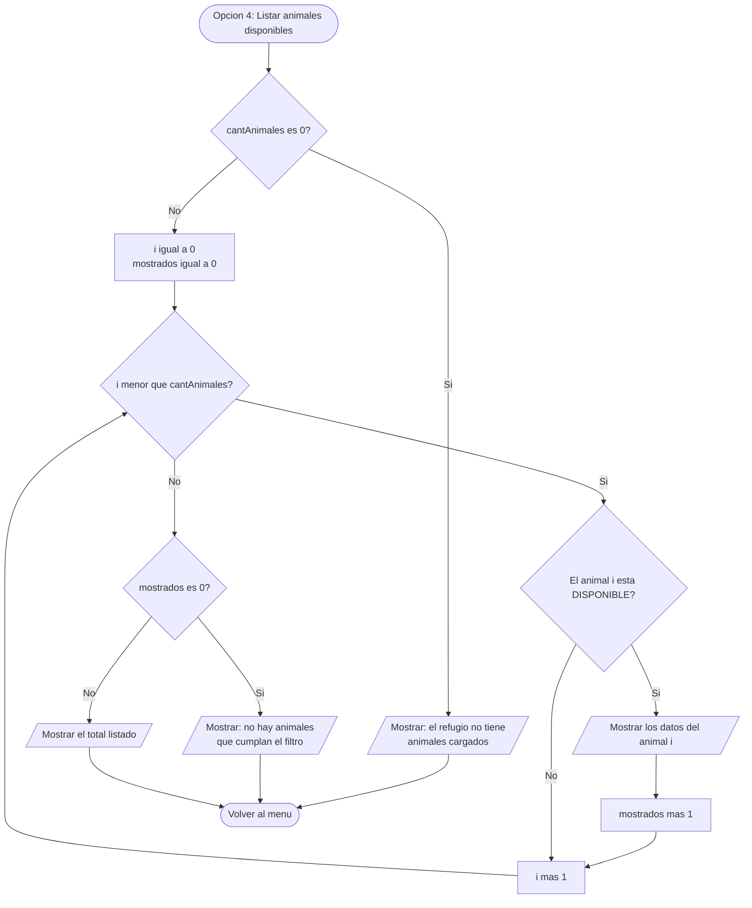

---

## Opción 5 — Registrar adoptante

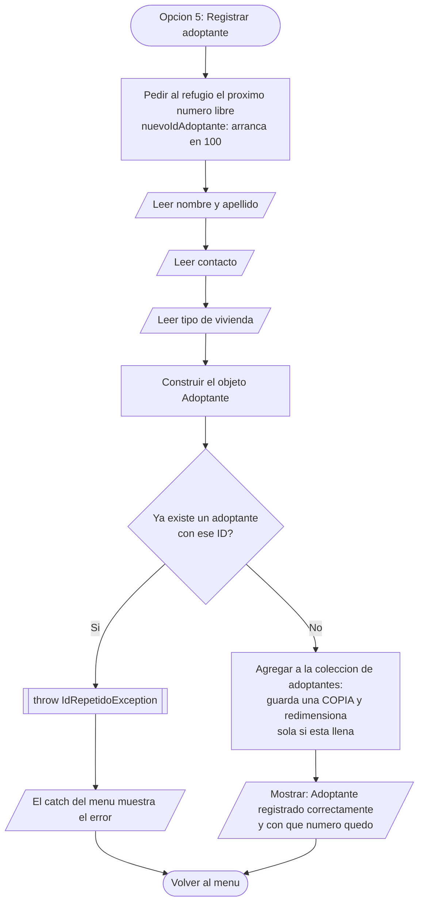

> A diferencia de los animales, los adoptantes se guardan **por valor** dentro de
> `Coleccion<Adoptante>`, que administra su propia memoria dinámica.
>
> Los números de adoptante arrancan en **100** y los de animal en **1**, así en pantalla
> nunca se confunde uno con el otro.

---

## Opción 6 — Ver ficha de un animal

Usa dos operadores sobrecargados de la Fase 3: `operator()` para buscar por ID y el
operador unario `operator!` para preguntar si el animal **no** está disponible. El ID que
recibe el `operator()` sale de la lista, no del teclado.

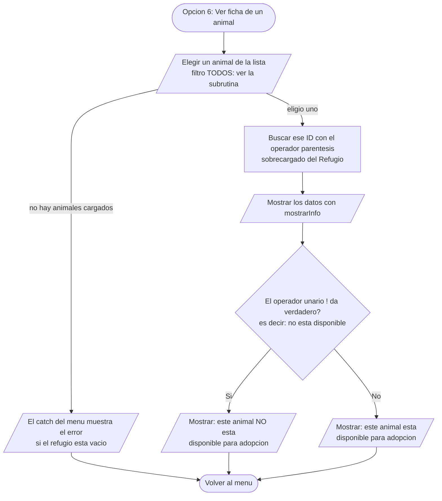

> Ya no hace falta el rombo de "¿se encontró el animal?": el ID viene de la lista que
> armó el propio sistema, así que el animal existe seguro. El `NoEncontradoException` del
> `operator()` sigue estando, pero ahora es una red del modelo y no un error esperable de
> la interfaz.

---

## Opción 7 — Crear solicitud de adopción

Es el proceso central del sistema. Reserva el animal (`EN_PROCESO`) y opcionalmente
confirma la adopción en el momento.

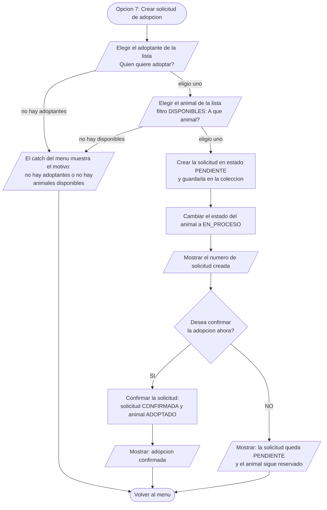

> **Comparado con la versión anterior este diagrama tiene cinco rombos menos.** Antes había
> que verificar que hubiera animales y adoptantes, leer los dos IDs y después comprobar uno
> por uno que existieran y que el animal estuviera disponible. Ahora:
>
> - los dos avisos de "no hay nada para elegir" los da la propia subrutina de selección;
> - "¿existe el adoptante?" y "¿existe el animal?" desaparecieron: los IDs salen de la lista;
> - el filtro `DISPONIBLES` hace que un animal reservado o adoptado **ni siquiera aparezca**,
>   así que tampoco hay que preguntar si está disponible.
>
> Las validaciones siguen existiendo dentro de `Refugio::crearSolicitud()` (incluido el
> `AnimalNoDisponibleException`, que usa el operador `!`), pero como reglas del modelo: la
> interfaz ya no puede provocarlas.

---

## Opción 8 — Confirmar solicitud

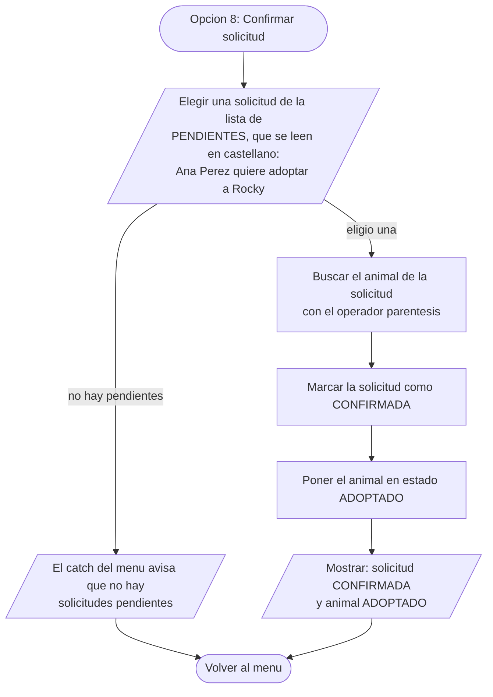

> **La lista sólo ofrece las PENDIENTES**, que son las únicas que se pueden confirmar.
> Antes se listaban todas y el usuario podía elegir una ya cerrada, para recién entonces
> recibir el error. Los dos rombos que verificaban eso siguen dentro de
> `Refugio::confirmarSolicitud()`, pero la interfaz ya no los puede disparar.

---

## Opción 9 — Cancelar solicitud

Igual que la opción 8, pero el animal **vuelve a estar disponible** en lugar de quedar
adoptado.

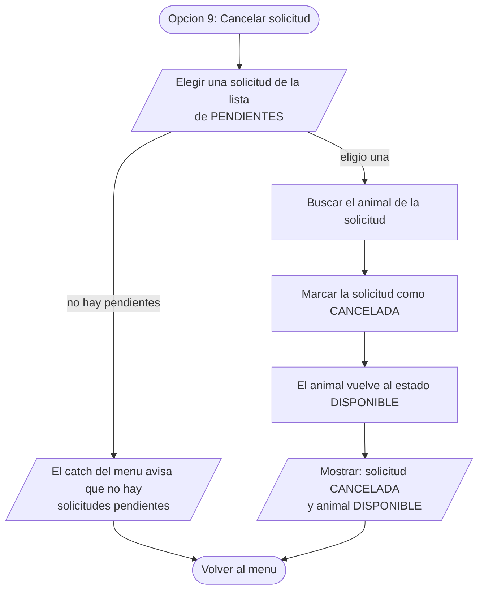

---

## Opción 10 — Devolver animal al refugio

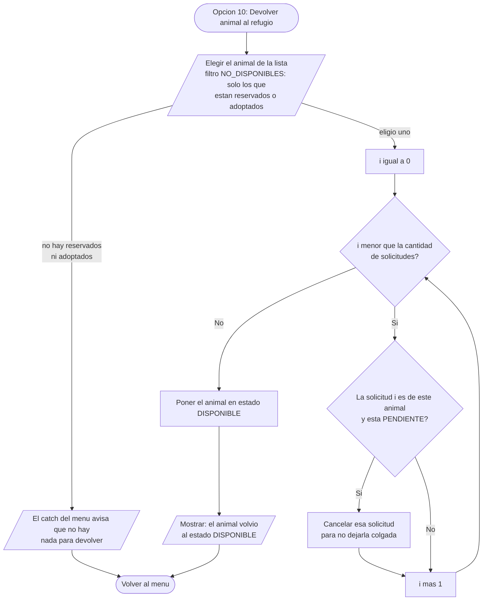

> El filtro `NO_DISPONIBLES` reemplazó al rombo de "¿el animal ya figura como
> DISPONIBLE?": un animal que nunca salió del refugio **no aparece en la lista**, así que
> no se puede elegir para devolver. El bucle que cancela la solicitud pendiente que pudiera
> tener ese animal sigue igual, dentro de `Refugio::devolverAnimal()`.

---

## Opción 11 — Ver adoptantes y solicitudes

Esta opción existe para mostrar la **función genérica** de la Fase 5: la misma función
`mostrarColeccion<T>()` se usa con dos tipos distintos.

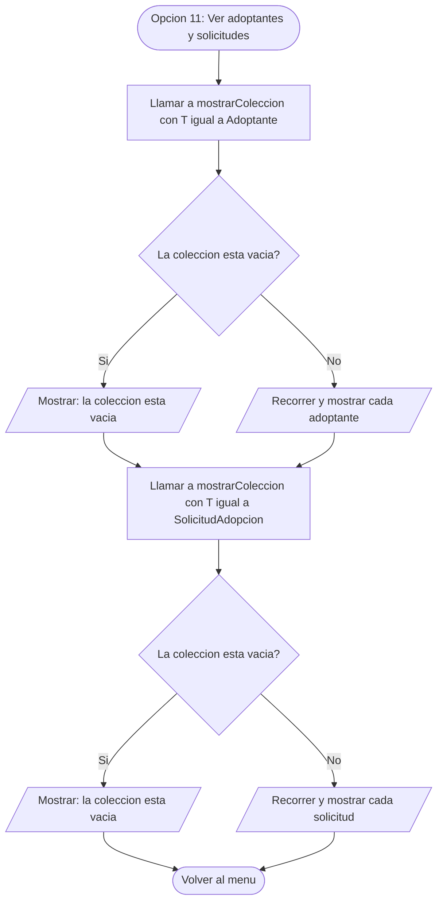

---

## Opción 12 — Historial de adopciones

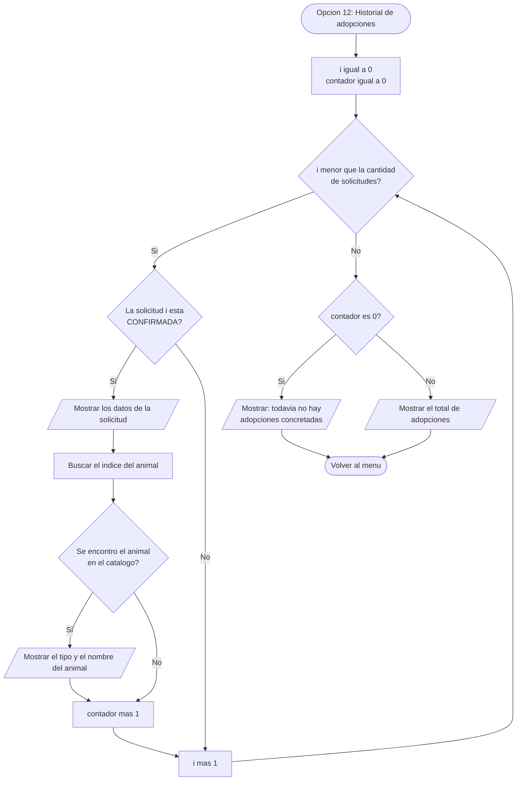

---

## Opción 13 — Informes y estadísticas

Recorre el catálogo y las solicitudes contando por estado, y después muestra los
**miembros estáticos**, que sirven para verificar que no queden fugas de memoria.

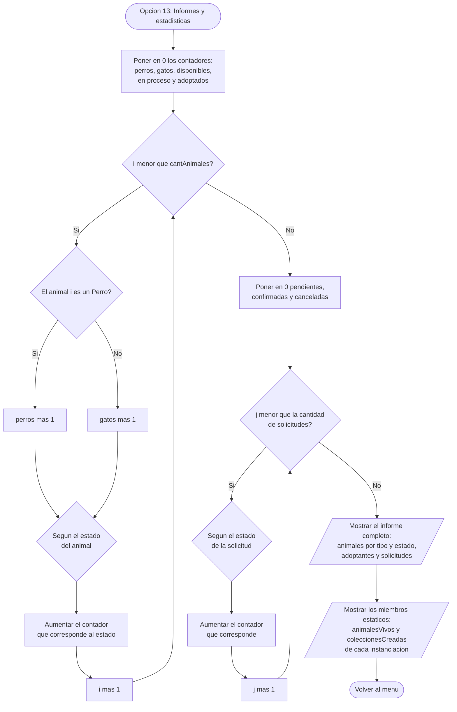

> `Coleccion<Adoptante>::coleccionesCreadas` y
> `Coleccion<SolicitudAdopcion>::coleccionesCreadas` son **contadores independientes**:
> el compilador genera una clase distinta por cada tipo `T` y cada una tiene su propia
> copia del miembro estático.

---

## Opción 14 — Pruebas de integridad

Esta opción concentra las pruebas que pide la consigna: aritmética de punteros, operadores,
copia profunda, liberación de memoria y excepciones.

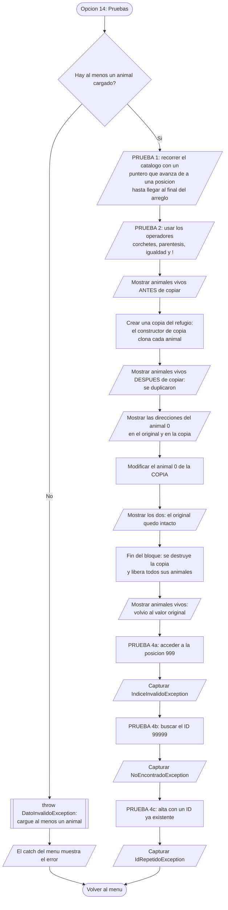

> Cada prueba de excepción tiene su **propio `try`** dentro de la función, para que una
> prueba no corte a la siguiente.

---

## Opción 0 — Salir del sistema

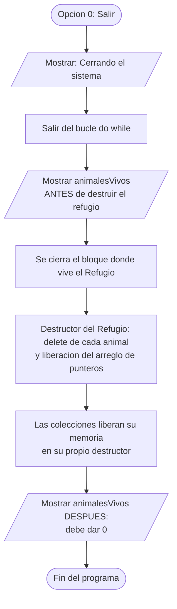

> Si el contador final da **0**, quedó demostrado que no hay fugas de memoria: todos los
> objetos creados con `new` fueron liberados.
